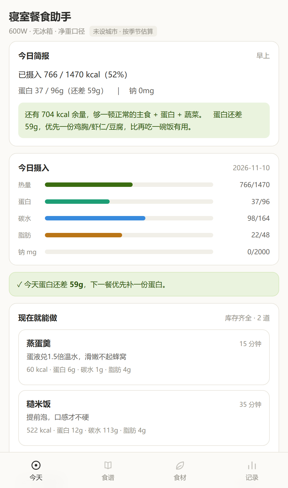
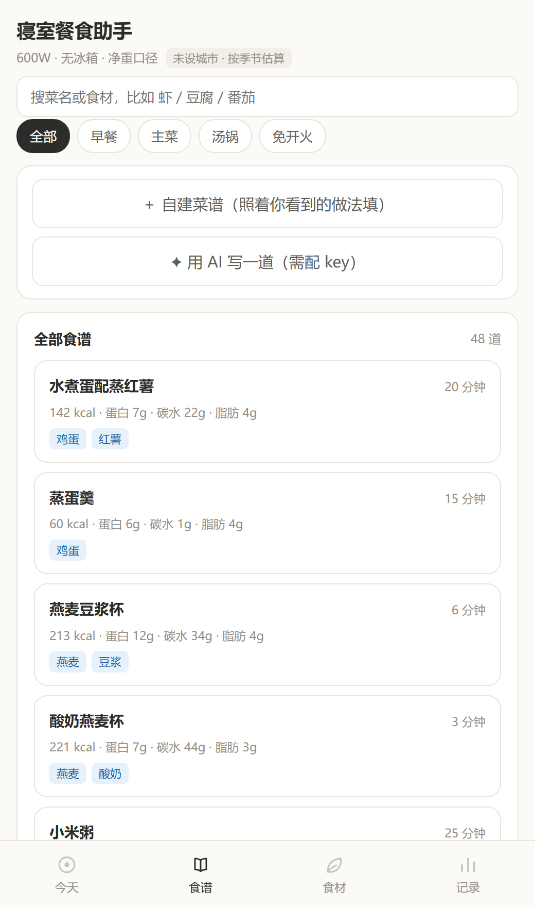

# 寝室餐食助手

一个装在自己手机里的「寝室减脂餐」记账 + 配餐工具。**单个 HTML 文件，零依赖，数据只存本机。**

在只有一口 600W 小锅、没有冰箱的寝室里，能做什么、今天该吃多少、买的菜还剩几天、食堂这顿大概多少卡——这个应用想把这四件事算清楚，并且每个数字都能查到来源。

<p align="center">
  
  
</p>

<sub>截图为示例数据。</sub>

## 功能

| 页面 | 做什么 |
|---|---|
| **今天** | 热量 / 蛋白 / 碳水 / 脂肪 / 钠 五条进度；按库存实时推荐「现在就能做」的菜；临期与浪费提醒；一句话简报（早上问早餐、晚上复盘） |
| **食谱** | 48 道寝室可做的菜，按早餐 / 主菜 / 汤锅 / 免开火筛选，可按菜名或食材搜索；每道都有分步做法、**判断熟没熟的标准**、**做失败长什么样** |
| **食材** | 234 条食材营养库（每 100g 可食部，标明生重 / 熟重 / 净重 / 干重），库存按到期排序，临期标红；支持计浪费 |
| **记录** | 记一笔：食堂菜（81 道常见菜，按配方估算）、加餐、直接吃库存、用库存做菜；支持手动输入或 AI 拆解、截图识别 |
| **设置** | 身体与目标（Mifflin-St Jeor）、本地天气修正保存期、AI Key、自定义食谱、数据导出 / 恢复 |

细节：开屏动画、底部弹层下拉手势、按压反馈、`prefers-reduced-motion` 降级；PWA 可添加到主屏离线使用；Android 壳工程额外提供原生 AI 通道（绕开 CORS）、相册选图、状态栏沉浸。

## 数据来源与边界

这个项目的原则是「**宁可标不确定，也不假装精确**」。

- **营养数值**：198 条来自《中国食物成分表 标准版（第 6 版）》，另有包装标签（荞麦面、辣椒面）、USDA SR Legacy（鸡腿 / 鸭腿去皮）与少量常见值，**每条食材都带来源字段**，界面上直接显示。
- **保存期不是实验数据**，是食品常识估算，再按当地气温分档修正。界面上写的是「常温 N 天」，不是保质期。
- **AI 只做结构化，不写数字**：AI 负责把「香菇滑鸡饭」拆成配料表、把做法写成步骤，所有营养数值一律回到本地库重算。拆不出来的食材会显式标红，可以手动指定或新建。
- **历史记录不随数据修正而变**：记账那一刻算好的数值就存下来了，后面改库也不会篡改旧账。
- 自建食材会标「自建食材（非成分表）」，不会被伪装成权威数据。

## 项目结构

```
寝室餐食助手.html          主程序（数据 + 逻辑 + 样式全部内联，约 200KB）
manifest.json / sw.js      PWA 配置与离线缓存
icon-*.png                 图标
_apk/                      Android 壳工程
  ├── AndroidManifest.xml
  ├── src/com/dorm/meal/MainActivity.java   WebView 宿主、AI 原生通道、相册选图、insets
  ├── res/                 主题与配色（含 Android 12+ 开屏图标消除）
  ├── assets/              打包时自动拷入的页面与图标
  └── build.sh             aapt2 → javac → d8 → zipalign → apksigner
docs/                      README 截图
```

## 使用

**网页版**：直接用浏览器打开 `寝室餐食助手.html`，或起个静态服务后访问（PWA 安装需要 http/https）：

```bash
python -m http.server 8000
# 浏览器打开 http://localhost:8000/寝室餐食助手.html
```

**Android**：用 `_apk/build.sh` 打包，需要 JDK、Python 3、Android SDK 的 build-tools 与 `android.jar`，无需 Android Studio。

```bash
cd _apk
export ANDROID_BUILD_TOOLS=/path/to/build-tools/34.0.0
export ANDROID_JAR=/path/to/platforms/android-34/android.jar
export DORM_KS=/path/to/your.jks        # 自己的签名密钥，仓库不含
export DORM_KS_ALIAS=dorm
export DORM_KS_PASS='******'            # 只用环境变量传，不要写进仓库
bash build.sh v3.1
```

> **签名密钥不入库。** 同一个包名如果用别人的密钥签名，会直接装不上或覆盖失败，所以 keystore 请自己保管。想二次开发的话，自己生成一个即可：`keytool -genkeypair -keystore release.jks -alias dorm -keyalg RSA -validity 10950`。

**AI 功能**（可选）：设置 → AI 写菜谱，填入兼容 OpenAI 格式的 Key 与模型名。不填也能用全部离线功能。

## 已知限制

- 保存期、食堂菜的用油量都是估算，误差在所难免；食堂菜按「配方 + 常见份量」推导，同一道菜不同窗口差别可能很大。
- 营养库以中式常见食材为主，进口 / 预制食品覆盖有限，遇到没有的自己新建更准。
- 单机应用，没有账号、没有云同步；换机请用「设置 → 数据 → 导出备份」。
- 只做过 Android（WebView）与桌面 Chrome 的验证，iOS Safari 未系统测试。

## 免责声明

个人自用工具，营养数值用于估算参考，不构成医学或营养学建议。有任何健康问题请咨询专业医师或注册营养师。
